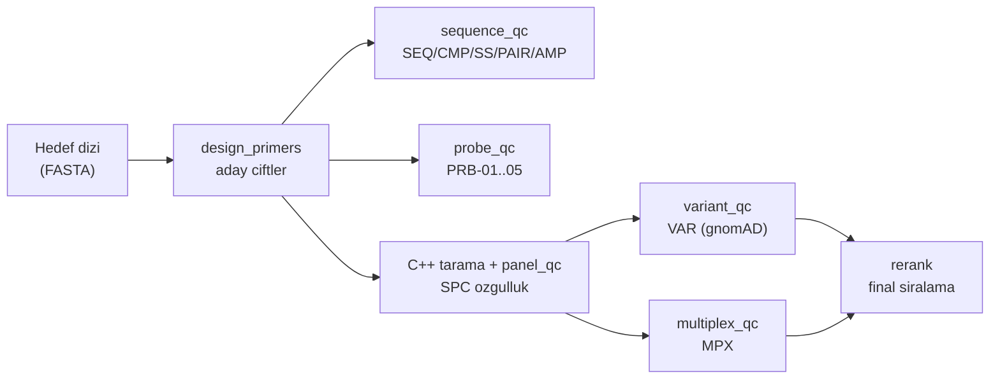

<p align="center">
  
</p>

<h1 align="center">OligoScout</h1>

<p align="center">
  <b>GRCh38 uzerinde termodinamik PCR primer/prob tasarimi ve kapsamli kalite kontrolu</b><br>
  <a href="https://oligoscout.org">oligoscout.org</a>
</p>

<p align="center">
  
  
  
  
  
  
</p>

---

OligoScout, GRCh38 insan referansi uzerinde **PCR primer/prob tasarimi** ve
**19 ailede 91 kurallik kapsamli kalite kontrolu** yapan, sifirdan yazilmis bir
hesaplamali termodinamik sistemdir. Hicbir dis termodinamik kutuphaneye bagli
degildir: en-yakin-komsu (NN) modeli, dimer hizalama, ikincil yapi katlanmasi,
tuz duzeltmeleri ve genom-geneli FM-index aramasi projenin kendi kodudur.

| Olcum | Deger |
|---|---|
| QC kurallari | 19 ailede 91; **90'i uygulandi** |
| Birim test | 264 (hepsi geciyor) |
| Uctan uca regresyon | 20 PASS / 1 SKIP / 0 FAIL |
| Python ↔ C++ diferansiyel | 74 dizi × 17 sutun, **0 fark** |
| Parametre capraz denetim | 373 karsilastirma (primer3 oracle) |
| C++ tarama (yayin paneli) | 1.024 cift · 8.262.803 baglanma · 111.8 s · 0.65 GiB |

> **Arastirma/bilgi amaclidir.** Esiklerin cogu literatur baslangic degerleridir
> ve **islak-lab verisiyle KALIBRE EDILMEMISTIR (REP-03)**. Ciktilar deneysel
> dogrulama yerine gecmez.

---

## Icindekiler

- [Mimari](#mimari)
- [Depo duzeni](#depo-duzeni)
- [Kurulum](#kurulum)
- [Veri dahil DEGILDIR](#veri-dahil-degildir--nasil-elde-edilir)
- [Boru hatti](#boru-hatti)
- [Araclar — girdi / komut / cikti](#araclar--girdi--komut--cikti)
- [Kanit kaydi semasi](#kanit-kaydi-semasi)
- [Dogrulama](#dogrulama)
- [Kalibrasyon uyarilari](#kalibrasyon-uyarilari-rep-03)
- [Lisans ve atif](#lisans-ve-atif)

---

## Mimari

OligoScout **iki bilesenli** bir monorepodur. Bu ayrim bilinclidir: Python katmani
C++ cekirdeginin hem spesifikasyonu hem de dogrulama oracle'idir.

| Bilesen | Klasor | Rol |
|---|---|---|
| **Python referans motoru** | [`reference_py/`](reference_py/) | Tum termodinamik + QC mantigi. Calistirilabilir, test edilebilir "referans gercek". Dis bagimlilik gerektirmez. |
| **C++20 cekirdek** | [`OligoScout/`](OligoScout/) | Genom-geneli FM-index (PPFM) aramasi ve yuksek basarimli tarama. WSL/Linux gerektirir. |

Bir hesap once Python'da tanimlanir ve test edilir, sonra C++'a tasinir; iki
uygulama **diferansiyel test** ile tolerans dahilinde karsilastirilir
(74 dizi × 17 sutun, 0 fark).



---

## Depo duzeni

```
OligoScout/                      <- GitHub deposu (koku)
|
├── reference_py/                Python referans motoru
│   ├── oligoscout_thermo/       termodinamik + QC (nn, align, fold, salt,
│   │                            seqpair, probe, variants, multiplex,
│   │                            bisulfite, isoform, params ...) — 20 modul
│   ├── cli/                     komut satiri araclari — 21 arac
│   └── tests/                   birim testler — 264
│
├── OligoScout/                  C++20 FM-index cekirdek (ayri bilesen)
│   ├── src/  include/           kaynak
│   ├── tests/ tools/ scripts/   test + yardimci
│   └── CMakeLists.txt
│
├── setup/                       WSL kurulum/boru-hatti betikleri (*.sh)
├── RUN_*.cmd                    Windows sarmalayicilari (WSL'yi cagirir)
├── assets/                      logo vb.
├── README.md                    bu dosya
└── README_KURULUM.md            ayrintili yerel kurulum
```

> **Not — ic ice `OligoScout/` klasoru neden var?** Depo koku tum PROJEyi
> (`OligoScout`) temsil eder; icindeki `OligoScout/` yalnizca **C++ bileseni**dir,
> `reference_py/` ise Python bilesenidir. Bu, iki dilli projelerde standart bir
> monorepo duzenidir (ornegin `reference_py/` + `OligoScout/` kardes bilesenler).
> Veri, indeksler ve uretilen ciktilar depoda YOKTUR (`.gitignore`).

---

## Kurulum

### Python referans motoru (dis bagimlilik gerektirmez)

```bash
cd reference_py
python -m unittest discover -s tests -p "test_*.py"   # 264 test
```

### C++ cekirdek (WSL/Linux)

Gereksinimler: Linux veya WSL2, C++20 derleyici, CMake ≥ 3.25, GNU Make.
Windows'ta tek giris noktasi **`RUN_SETUP.cmd`** (cift tiklayin) — her sey WSL
icinde sirayla calisir (bkz. `README_KURULUM.md`). Elle:

```bash
cd OligoScout
cmake --preset release
cmake --build --preset release
```

---

## Veri dahil DEGILDIR — nasil elde edilir

Depo yalniz **kaynak kod** icerir (~1 MB). Asagidaki veriler yereldir ve
`.gitignore` ile dislanir; `setup/` betikleriyle kurulur:

| Veri | Kaynak | Yerel yol |
|---|---|---|
| GRCh38.p14 referans (~3.1 GB) | NCBI RefSeq | `OligoScout/data/genomes/` |
| PPFM FM-index (24 shard, ~8.5 GB) | `RUN_SETUP.cmd` faz 8 | `OligoScout/data/indexes/ppfm/` |
| GENCODE v47 anotasyon (GTF) | GENCODE | `OligoScout/data/annotations/` |
| UCSC genomicSuperDups | UCSC Table Browser | `OligoScout/data/annotations/` |
| Bisulfit CT/GA indeksleri | `RUN_BISULFITE_INDEX.cmd` | `OligoScout/data/indexes/bisulfite/` |
| primer3 (parametre capraz denetimi) | github.com/primer3-org/primer3 | `OligoScout/third_party/primer3/` |

---

## Boru hatti

Windows'ta `RUN_*.cmd` sarmalayicilari ilgili adimi WSL uzerinden calistirir.
Tipik tasarim akisi:

| # | Script | Ne yapar |
|---|---|---|
| 1 | `RUN_DESIGN.cmd` | Hedef bolgeden aday primer ciftleri |
| 2 | `RUN_SEQUENCE_QC.cmd` | Dizi/kompozisyon/cift/amplikon QC |
| 3 | `RUN_THERMO.cmd` | Termodinamik rapor + erime egrileri |
| 4 | `RUN_PANEL.cmd` | Genom-geneli ozgulluk taramasi + panel QC |
| 5 | `RUN_VARIANT.cmd` | Varyant katmani (gnomAD) |
| 6 | `RUN_MELT.cmd` | Amplikon erime profili |

Ozel akislar: `RUN_BLOCKER.cmd` (CT-05), `RUN_BISULFITE_INDEX.cmd` +
`RUN_BISULFITE_PANEL.cmd` (bisulfit), `RUN_ISOFORM.cmd` (RT-03),
`RUN_ANNOTATIONS.cmd`, `RUN_REGRESYON.cmd`, `RUN_DIFF_CPP.cmd`.

---

## Araclar — girdi / komut / cikti

Tum QC araclari ortak bir **kanit kaydi** semasi uretir (asagiya bakin). Onem
dereceleri: `INFO` (bilgi) · `WARN` (riskli) · `FAIL` (kurali gecmiyor).

### 1) Primer tasarimi — `design_primers.py`

**Girdi:** hedef FASTA (tek dizi). **Komut:**

```bash
python reference_py/cli/design_primers.py \
    --target hedef.fa --profile ctdna --out out/design_ctdna \
    --product 60:100 --tm 58:62 --max-pairs 2000 --top 50
```

**Cikti** (`out/design_ctdna/`): `design_pairs.tsv` (secilen ciftler),
`design_candidates.tsv`, `design_rejections.tsv`, `design_panel.tsv`.

`design_pairs.tsv` sutunlari: `left_primer  right_primer  product_start
product_end  product_length  tm_left_c  tm_right_c  delta_tm_c
heterodimer_dG37  heterodimer3p_dG37  uncalibrated_score  pareto_rank`.

### 2) Dizi/cift QC — `sequence_qc.py`

**Girdi:** `--design` klasoru (`design_pairs.tsv`) + `--target` FASTA. **Komut:**

```bash
python reference_py/cli/sequence_qc.py \
    --design out/design_ctdna --target hedef.fa --profile ctdna \
    --na 50 --mg 1.5 --dntp 0.6 --primer-nm 200 --ta 60
```

Opsiyonel: `--probes prob.tsv` (DIM-05 + SS-05), `--tails F:R` (DIM-07 kuyruk),
`--contigs chrM.fa` (SPC-08), `--profile bisulfite --msp` (BIS-01/02/03).

**Cikti:** `seqpair_qc.tsv` (sutunlar: `pair_id  role  check  severity  value
threshold  note`), `seqpair_panel.tsv` (cift basina karar), `seqpair_qc_records.jsonl`.

### 3) Prob secimi — `probe_qc.py`

**Girdi:** `--design` + `--target`. **Komut:**

```bash
python reference_py/cli/probe_qc.py \
    --design out/design_ctdna --target hedef.fa --profile ddpcr --tm-delta 6:10
```

**Cikti:** `probe_qc.tsv`, `probe_panel.tsv` (PRB-01..05 kararlari).

### 4) Ozgulluk — `panel_qc.py` (C++ tarama ciktisini birlestirir)

**Girdi:** C++ `oligoscout_panel` onek ciktilari (`<prefix>.bindings.tsv`,
`.products.tsv`, `.contract.tsv`). Tam akis `RUN_PANEL.cmd` ile. **Komut:**

```bash
python reference_py/cli/panel_qc.py \
    --prefix out/panel/panel --out out/panel --panel panel.tsv \
    --ta 60 --anchor 12
```

**Cikti:** `panel_qc.tsv` (cift basina ozgulluk + termodinamik ozet),
`offtarget_products.tsv`, `panel_qc_records.jsonl` (SPC-01..09, COND-01/02).

### 5) Varyant katmani — `variant_qc.py`

**Girdi:** `--panel` + `--design`. gnomAD v4 sorgulanir (`--offline` ile cache).
**Cikti:** `variant_qc.tsv`, `variant_sites.tsv`, `variant_qc_records.jsonl`
(VAR-01..08: primer/prob altinda varyant, alel frekansi, 3' konumu).

### 6) Blocker / alel ayrimi — `blocker_qc.py` (CT-05)

**Girdi:** `--mutant` ve `--wt` prob dizileri (LNA/uc notasyonu kabul edilir),
opsiyonel `--forward/--reverse/--blocker`. **Komut:**

```bash
python reference_py/cli/blocker_qc.py \
    --mutant "CCC+CT+C+T+C+TGAC" --wt "C+CT+C+T+ATG+A+CC" \
    --forward AGTCCTTTCTGTGTCTTCCCA --reverse TCCAGCATCTCCAGCAGC
```

**Cikti:** `ct05_qc.tsv` (prob ΔTm; LNA "alt sinir" etiketli), `ct05_qc_records.jsonl`.

### 7) Amplikon erime — `amplicon_melt.py`

**Girdi:** `--design`+`--target` ya da `--sequences`. **Cikti:** `amplicon_melt.tsv`,
`amplicon_melt_curves.tsv`, **`amplicon_melt.png`** (dθ/dT erime egrisi; QPCR-02/AMP-02).

### 8) Multipleks — `multiplex_qc.py`

**Girdi:** C++ tarama oneki (`--prefix`) + `--panel`. Yeni tarama yapmaz; caprazlar
mevcut baglanma kayitlarindan kurulur. **Cikti:** `dimer_matrix.tsv`,
`cross_products.tsv`, `multiplex_summary.tsv` (MPX-01..03).

### 9) Bisulfit — indeks + iplik ozgullugu

```bash
# (a) donusturulmus genom indeksi (agir; JOBS ile paralel)
JOBS=6 bash setup/run_bisulfite_index.sh
# (b) BIS-04 iplik ozgullugu: CT/GA taramasi
PANEL=panel.tsv INTENDED=CT bash setup/run_bisulfite_panel.sh
```

**Cikti:** `OligoScout/data/indexes/bisulfite/{CT,GA}/` + `bisulfite_qc.tsv`
(cift basina BIS-04). BIS-01/02/03 ise `sequence_qc --profile bisulfite` ile.

### 10) Izoform kapsami — `isoform_qc.py` (RT-03)

**Girdi:** `--pairs` TSV (`pair_id  gene  chrom  fwd_start  fwd_end  rev_start
rev_end`, GENOM koordinatlari) + `--exons transcript_exons.tsv` (GENCODE'dan
`build_annotations.py` uretir). **Cikti:** `isoform_qc.tsv` (hedeflenen/
hedeflenmeyen transkript listesi). Transkriptom FM-index GEREKMEZ.

---

## Kanit kaydi semasi

Her kontrol bir **REP-02 kanit kaydi** uretir (JSONL). Ornek:

```json
{
  "id": "SS-05", "target": "P1_probe", "severity": "INFO",
  "value": {"structure_tm_c": null, "lna_count": 6, "anneal_c": 60.0},
  "threshold": {"warn": "Tm_yapi > 50 C", "fail": "Tm_yapi > 60 C"},
  "model": {"source": "fold.zuker_mfe"},
  "conditions": {"monovalent_mM": 50, "magnesium_mM": 1.5, "free_magnesium_mM": 0.9,
                 "dntp_mM": 0.6, "primer_nM": 200, "anneal_c": 60.0},
  "param_set_sha256": "fb9ff51b36e905c8...",
  "note": "6 LNA -> bildirilen Tm ALT SINIR"
}
```

Ayni girdi + kosul + `param_set_sha256` **deterministik ayni** sonucu verir;
referans FASTA'nin SHA-256'si (SEQ-06) sonucla saklanir.

---

## Dogrulama

| Arac | Ne yapar | Sonuc |
|---|---|---|
| Birim testler | `reference_py/tests/` | 264, hepsi geciyor |
| `param_crosscheck.py` | Tablolar vs primer3 (bagimsiz oracle) | 373 karsilastirma, 0 transkripsiyon hatasi |
| `diff_cpp.py` | Python ↔ C++ diferansiyel | 74 dizi × 17 sutun, 0 fark |
| `regresyon.py` | 21 adimli uctan uca | 20 PASS / 1 SKIP / 0 FAIL |

Capraz denetim `verified` durumu VERMEZ; ikinci insan aktarimi hala gerekir.

---

## Kalibrasyon uyarilari (REP-03)

1. Esiklerin cogu literatur baslangic degerleridir, **kalibre EDILMEMISTIR**.
2. LNA/modifiye baz katkisi modellenmez; ilgili Tm'ler **ALT SINIRDIR**.
3. Parametre tablolari "aktarildi, dogrulanmadi" durumundadir.
4. A·T bulge kapanis sabiti bir proje modelleme kararidir.
5. Tek kismi kural: SPC-08 (buyuk ALT contig'leri icin C++ FM-index).

---

## Lisans ve atif

Termodinamik parametreler orijinal yayinlara aittir (SantaLucia 1998,
Allawi & Peyret, Bommarito 2000, SantaLucia & Hicks 2004, SantaLucia & Peyret
2001, Sugimoto 1995); atiflar `reference_py/oligoscout_thermo/params.py`
kunyelerindedir. Proje lisansi icin depo kokune bakin.

<p align="center"><a href="https://oligoscout.org">oligoscout.org</a></p>
