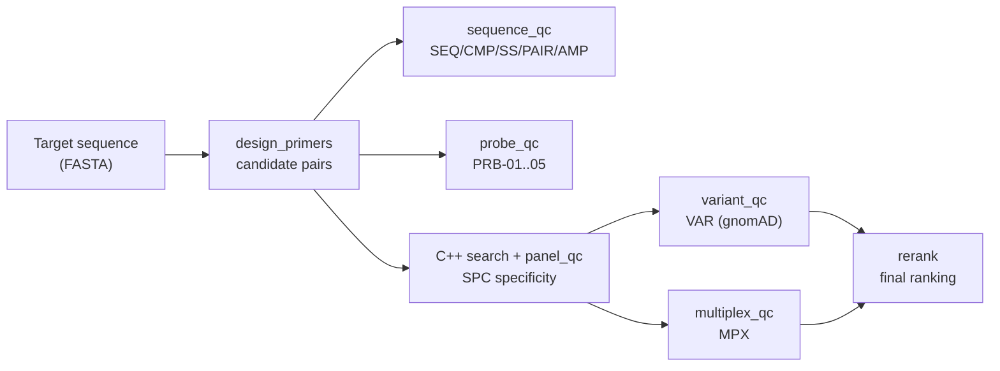

<p align="center">
  
</p>

<h1 align="center">OligoScout</h1>

<p align="center">
  <b>Thermodynamic PCR primer/probe design and comprehensive quality control on GRCh38</b><br>
  <a href="https://oligoscout.org">oligoscout.org</a>
</p>

<p align="center">
  
  
  
  
  
  
</p>

---

OligoScout is a from-scratch computational thermodynamic system for **PCR
primer/probe design** and **comprehensive quality control (91 rules across 19
families)** on the GRCh38 human reference. It depends on no external
thermodynamics library: the nearest-neighbor (NN) model, dimer alignment,
secondary-structure folding, salt corrections, and genome-wide FM-index search
are all the project's own code.

| Metric | Value |
|---|---|
| QC rules | 91 across 19 families; **90 implemented** |
| Unit tests | 264 (all passing) |
| End-to-end regression | 20 PASS / 1 SKIP / 0 FAIL |
| Python ↔ C++ differential | 74 sequences × 17 columns, **0 differences** |
| Parameter cross-check | 373 comparisons (primer3 oracle) |
| C++ search (publication panel) | 1,024 pairs · 8,262,803 bindings · 111.8 s · 0.65 GiB |

> **For research/informational use.** Most thresholds are literature starting
> values and are **NOT calibrated against wet-lab data (REP-03)**. Outputs do not
> replace experimental validation.

---

## Table of contents

- [Architecture](#architecture)
- [Repository layout](#repository-layout)
- [Installation](#installation)
- [Data is NOT included](#data-is-not-included--how-to-obtain-it)
- [Pipeline](#pipeline)
- [Tools — input / command / output](#tools--input--command--output)
- [Evidence record schema](#evidence-record-schema)
- [Validation](#validation)
- [Calibration caveats](#calibration-caveats-rep-03)
- [License and citation](#license-and-citation)

---

## Architecture

OligoScout is a **two-component monorepo**. The split is deliberate: the Python
layer is both the specification and the validation oracle for the C++ core.

| Component | Folder | Role |
|---|---|---|
| **Python reference engine** | [`reference_py/`](reference_py/) | All thermodynamics + QC logic. Runnable, testable "ground truth". No external dependencies. |
| **C++20 core** | [`OligoScout/`](OligoScout/) | Genome-wide FM-index (PPFM) search and high-performance scanning. Requires WSL/Linux. |

A computation is first defined and tested in Python, then ported to C++; the two
implementations are compared within tolerance by a **differential test**
(74 sequences × 17 columns, 0 differences).



---

## Repository layout

```
OligoScout/                      <- GitHub repository (root)
|
├── reference_py/                Python reference engine
│   ├── oligoscout_thermo/       thermodynamics + QC (nn, align, fold, salt,
│   │                            seqpair, probe, variants, multiplex,
│   │                            bisulfite, isoform, params ...) — 20 modules
│   ├── cli/                     command-line tools — 21 tools
│   └── tests/                   unit tests — 264
│
├── OligoScout/                  C++20 FM-index core (separate component)
│   ├── src/  include/           source
│   ├── tests/ tools/ scripts/   tests + helpers
│   └── CMakeLists.txt
│
├── setup/                       WSL setup/pipeline scripts (*.sh)
├── RUN_*.cmd                    Windows wrappers (invoke WSL)
├── assets/                      logo etc.
├── README.md                    this file
└── README_KURULUM.md            detailed local setup (Turkish)
```

> **Why is there a nested `OligoScout/` folder?** The repository root represents
> the whole PROJECT (`OligoScout`); the inner `OligoScout/` is only the **C++
> component**, while `reference_py/` is the Python component. This is a standard
> monorepo layout for bilingual projects (`reference_py/` and `OligoScout/` are
> sibling components). Data, indexes, and generated outputs are NOT in the
> repository (`.gitignore`).

---

## Installation

### Python reference engine (no external dependencies)

```bash
cd reference_py
python -m unittest discover -s tests -p "test_*.py"   # 264 tests
```

### C++ core (WSL/Linux)

Requirements: Linux or WSL2, a C++20 compiler, CMake >= 3.25, GNU Make. On
Windows the single entry point is **`RUN_SETUP.cmd`** (double-click) — everything
runs sequentially inside WSL (see `README_KURULUM.md`). Manually:

```bash
cd OligoScout
cmake --preset release
cmake --build --preset release
```

---

## Data is NOT included — how to obtain it

The repository contains only **source code** (~1 MB). The data below is local and
excluded via `.gitignore`; it is installed by the `setup/` scripts:

| Data | Source | Local path |
|---|---|---|
| GRCh38.p14 reference (~3.1 GB) | NCBI RefSeq | `OligoScout/data/genomes/` |
| PPFM FM-index (24 shards, ~8.5 GB) | `RUN_SETUP.cmd` phase 8 | `OligoScout/data/indexes/ppfm/` |
| GENCODE v47 annotation (GTF) | GENCODE | `OligoScout/data/annotations/` |
| UCSC genomicSuperDups | UCSC Table Browser | `OligoScout/data/annotations/` |
| Bisulfite CT/GA indexes | `RUN_BISULFITE_INDEX.cmd` | `OligoScout/data/indexes/bisulfite/` |
| primer3 (parameter cross-check) | github.com/primer3-org/primer3 | `OligoScout/third_party/primer3/` |

---

## Pipeline

On Windows, `RUN_*.cmd` wrappers run each step via WSL. A typical design flow:

| # | Script | What it does |
|---|---|---|
| 1 | `RUN_DESIGN.cmd` | Candidate primer pairs from a target region |
| 2 | `RUN_SEQUENCE_QC.cmd` | Sequence/composition/pair/amplicon QC |
| 3 | `RUN_THERMO.cmd` | Thermodynamic report + melting curves |
| 4 | `RUN_PANEL.cmd` | Genome-wide specificity search + panel QC |
| 5 | `RUN_VARIANT.cmd` | Variant layer (gnomAD) |
| 6 | `RUN_MELT.cmd` | Amplicon melting profile |

Specialized flows: `RUN_BLOCKER.cmd` (CT-05), `RUN_BISULFITE_INDEX.cmd` +
`RUN_BISULFITE_PANEL.cmd` (bisulfite), `RUN_ISOFORM.cmd` (RT-03),
`RUN_ANNOTATIONS.cmd`, `RUN_REGRESYON.cmd`, `RUN_DIFF_CPP.cmd`.

---

## Tools — input / command / output

Every QC tool emits a common **evidence record** schema (see below). Severities:
`INFO` (informational) · `WARN` (risky) · `FAIL` (fails the rule).

### 1) Primer design — `design_primers.py`

**Input:** a target FASTA (single sequence). **Command:**

```bash
python reference_py/cli/design_primers.py \
    --target target.fa --profile ctdna --out out/design_ctdna \
    --product 60:100 --tm 58:62 --max-pairs 2000 --top 50
```

**Output** (`out/design_ctdna/`): `design_pairs.tsv` (selected pairs),
`design_candidates.tsv`, `design_rejections.tsv`, `design_panel.tsv`.

`design_pairs.tsv` columns: `left_primer  right_primer  product_start
product_end  product_length  tm_left_c  tm_right_c  delta_tm_c
heterodimer_dG37  heterodimer3p_dG37  uncalibrated_score  pareto_rank`.

### 2) Sequence/pair QC — `sequence_qc.py`

**Input:** a `--design` folder (`design_pairs.tsv`) + a `--target` FASTA. **Command:**

```bash
python reference_py/cli/sequence_qc.py \
    --design out/design_ctdna --target target.fa --profile ctdna \
    --na 50 --mg 1.5 --dntp 0.6 --primer-nm 200 --ta 60
```

Optional: `--probes probe.tsv` (DIM-05 + SS-05), `--tails F:R` (DIM-07 tails),
`--contigs chrM.fa` (SPC-08), `--profile bisulfite --msp` (BIS-01/02/03).

**Output:** `seqpair_qc.tsv` (columns: `pair_id  role  check  severity  value
threshold  note`), `seqpair_panel.tsv` (per-pair verdict), `seqpair_qc_records.jsonl`.

### 3) Probe selection — `probe_qc.py`

**Input:** `--design` + `--target`. **Command:**

```bash
python reference_py/cli/probe_qc.py \
    --design out/design_ctdna --target target.fa --profile ddpcr --tm-delta 6:10
```

**Output:** `probe_qc.tsv`, `probe_panel.tsv` (PRB-01..05 verdicts).

### 4) Specificity — `panel_qc.py` (merges the C++ search output)

**Input:** C++ `oligoscout_panel` prefixed outputs (`<prefix>.bindings.tsv`,
`.products.tsv`, `.contract.tsv`). Full flow via `RUN_PANEL.cmd`. **Command:**

```bash
python reference_py/cli/panel_qc.py \
    --prefix out/panel/panel --out out/panel --panel panel.tsv \
    --ta 60 --anchor 12
```

**Output:** `panel_qc.tsv` (per-pair specificity + thermodynamic summary),
`offtarget_products.tsv`, `panel_qc_records.jsonl` (SPC-01..09, COND-01/02).

### 5) Variant layer — `variant_qc.py`

**Input:** `--panel` + `--design`. Queries gnomAD v4 (`--offline` uses a cache).
**Output:** `variant_qc.tsv`, `variant_sites.tsv`, `variant_qc_records.jsonl`
(VAR-01..08: variant under primer/probe, allele frequency, 3' position).

### 6) Blocker / allele discrimination — `blocker_qc.py` (CT-05)

**Input:** `--mutant` and `--wt` probe sequences (LNA/end notation accepted),
optional `--forward/--reverse/--blocker`. **Command:**

```bash
python reference_py/cli/blocker_qc.py \
    --mutant "CCC+CT+C+T+C+TGAC" --wt "C+CT+C+T+ATG+A+CC" \
    --forward AGTCCTTTCTGTGTCTTCCCA --reverse TCCAGCATCTCCAGCAGC
```

**Output:** `ct05_qc.tsv` (probe ΔTm; LNA labeled as a "lower bound"),
`ct05_qc_records.jsonl`.

### 7) Amplicon melting — `amplicon_melt.py`

**Input:** `--design`+`--target` or `--sequences`. **Output:** `amplicon_melt.tsv`,
`amplicon_melt_curves.tsv`, **`amplicon_melt.png`** (dθ/dT melting curve; QPCR-02/AMP-02).

### 8) Multiplex — `multiplex_qc.py`

**Input:** C++ search prefix (`--prefix`) + `--panel`. Runs no new search; cross
products are built from existing binding records. **Output:** `dimer_matrix.tsv`,
`cross_products.tsv`, `multiplex_summary.tsv` (MPX-01..03).

### 9) Bisulfite — index + strand specificity

```bash
# (a) converted-genome index (heavy; parallel with JOBS)
JOBS=6 bash setup/run_bisulfite_index.sh
# (b) BIS-04 strand specificity: CT/GA search
PANEL=panel.tsv INTENDED=CT bash setup/run_bisulfite_panel.sh
```

**Output:** `OligoScout/data/indexes/bisulfite/{CT,GA}/` + `bisulfite_qc.tsv`
(per-pair BIS-04). BIS-01/02/03 come from `sequence_qc --profile bisulfite`.

### 10) Isoform coverage — `isoform_qc.py` (RT-03)

**Input:** a `--pairs` TSV (`pair_id  gene  chrom  fwd_start  fwd_end  rev_start
rev_end`, GENOMIC coordinates) + `--exons transcript_exons.tsv` (produced from
GENCODE by `build_annotations.py`). **Output:** `isoform_qc.tsv` (targeted /
untargeted transcript list). No transcriptome FM-index required.

---

## Evidence record schema

Each check emits a **REP-02 evidence record** (JSONL). Example:

```json
{
  "id": "SS-05", "target": "P1_probe", "severity": "INFO",
  "value": {"structure_tm_c": null, "lna_count": 6, "anneal_c": 60.0},
  "threshold": {"warn": "Tm_structure > 50 C", "fail": "Tm_structure > 60 C"},
  "model": {"source": "fold.zuker_mfe"},
  "conditions": {"monovalent_mM": 50, "magnesium_mM": 1.5, "free_magnesium_mM": 0.9,
                 "dntp_mM": 0.6, "primer_nM": 200, "anneal_c": 60.0},
  "param_set_sha256": "fb9ff51b36e905c8...",
  "note": "6 LNA -> reported Tm is a LOWER BOUND"
}
```

The same input + conditions + `param_set_sha256` yields a **deterministic,
identical** result; the reference FASTA SHA-256 (SEQ-06) is stored with the result.

---

## Validation

| Tool | What it does | Result |
|---|---|---|
| Unit tests | `reference_py/tests/` | 264, all passing |
| `param_crosscheck.py` | Tables vs primer3 (independent oracle) | 373 comparisons, 0 transcription errors |
| `diff_cpp.py` | Python ↔ C++ differential | 74 sequences × 17 columns, 0 differences |
| `regresyon.py` | 21-step end-to-end | 20 PASS / 1 SKIP / 0 FAIL |

The cross-check does NOT grant `verified` status; a second human transcription is
still required.

---

## Calibration caveats (REP-03)

1. Most thresholds are literature starting values and are **NOT calibrated**.
2. LNA/modified-base contributions are not modeled; the related Tm values are a
   **LOWER BOUND**.
3. Parameter tables are in a "transcribed, unverified" state.
4. The A·T bulge-closure constant is a project modeling decision.
5. Only one partial rule: SPC-08 (large ALT contigs need the C++ FM-index).

---

## License and citation

Thermodynamic parameters belong to their original publications (SantaLucia 1998,
Allawi & Peyret, Bommarito 2000, SantaLucia & Hicks 2004, SantaLucia & Peyret
2001, Sugimoto 1995); citations are in the provenance of
`reference_py/oligoscout_thermo/params.py`. For the project license see the
repository root.

<p align="center"><a href="https://oligoscout.org">oligoscout.org</a></p>
